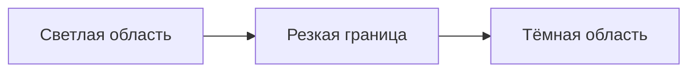

# 01 — С чего начать

Эта глава сделана как инструкция к инструменту. Не требуется придумывать изображение в голове. Смотри на готовую картинку и ищи конкретные признаки.

## 1. Тег — не переключатель

Промпт — это подсказка модели, а не набор точных команд. Например, `soft shading` означает «мягкое затенение». Модель не запускает специальный режим с таким названием. Она пытается построить изображение, похожее на визуальные примеры, связанные с этим выражением во время обучения.

- тег может помочь, но не всегда;
- одинаковые слова могут дать разные результаты в разных сценах;
- два близких тега могут почти не отличаться;
- слишком много противоречивых слов усложняет управление.

## 2. Как читать термин

На примере `soft shading`:

| Часть | Значение |
|---|---|
| `soft` | мягкий |
| `shading` | затенение, переход от света к тени |
| Всё выражение | мягкое затенение |
| Что искать глазами | граница между светом и тенью менее резкая; переход плавнее |
| С чем сравнить | `cel shading` |
| Что не гарантируется | мягкие тени появятся именно на лице, а не в других местах |

Слова иногда имеют специальное значение в сообществе генерации. Если буквальный перевод не объясняет результат, ориентируйся на примеры и употребление, а не только на корень.

## 3. Наглядная схема: резкая и плавная тень

Это условная схема для `cel shading`. У `soft shading` переход между светлым и тёмным обычно растянут и плавнее.

### Что сравнивать
1. Посмотри на щёки, нос, подбородок и шею.
2. Найди границу тени.
3. Проверь, похожа ли она на чёткий край или на растушёванный переход.
4. Игнорируй остальные различия на первом проходе.

## 4. Что означает оценка уверенности

- **Высокая** — понятие конкретное и обычно наблюдаемое, например `full body` или `white background`.
- **Средняя** — понятие знакомое, но может влиять на несколько элементов, например `soft lighting`.
- **Эксперимент** — широкое или неоднозначное выражение, например `cinematic` или `beautiful art`.

Это не научная оценка модели. Это подсказка о том, насколько прямолинейно стоит ожидать эффект.

## 5. Четыре группы промпта

Для удобства разделяй запрос мысленно на блоки. В самом Forge это по-прежнему одна строка с тегами через запятую.

1. **Качество и эстетика:** `masterpiece, best quality, amazing quality`
2. **Субъект:** `1girl, long hair, blue eyes`
3. **Обработка:** `soft shading, clean lineart, warm lighting`
4. **Сцена:** `forest, stone bridge, sunlight through trees, detailed background`

Если хочешь узнать влияние одного тега, не меняй одновременно все четыре блока.

## 6. Что сначала НЕ нужно делать

- Не добавляй `cel shading, soft shading, hard shadows, soft shadows` все вместе, если исследуешь именно тени.
- Не переноси автоматически quality-теги из Pony или SD 1.5.
- Не меняй seed, разрешение, sampler и промпт одновременно.
- Не оценивай тег только по одному случайному результату.
- Не делай вывод, что тег бесполезен после одного теста.

## 7. Мини-словарь английских корней

| Слово | Буквально | Примеры |
|---|---|---|
| `soft` | мягкий | `soft lighting`, `soft shading` |
| `hard` | жёсткий | `hard shadows` |
| `thin` | тонкий | `thin lineart` |
| `thick` | толстый | `thick outlines` |
| `warm` | тёплый | `warm lighting`, `warm palette` |
| `cool` | прохладный | `cool lighting` |
| `vibrant` | яркий, насыщенный | `vibrant colors` |
| `muted` | приглушённый | `muted colors` |
| `detailed` | детализированный | `detailed hair`, `detailed background` |
| `painterly` | напоминающий живопись | `painterly rendering` |
| `lineart` | линейный рисунок / контуры | `clean lineart` |
| `rendering` | визуальная проработка | `painterly rendering` |

## Следующий шаг

Открой [словарь художественных тегов](02-style-dictionary.md), но выбери одну категорию за раз. Начинать разумнее с теней, потому что разницу часто можно увидеть непосредственно на лице.