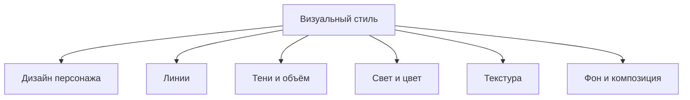

# 02 — Словарь художественных тегов

Здесь собраны теги, которые описывают визуальную обработку. Они не являются командами с гарантированным эффектом: это практические гипотезы для проверки на WAI Illustrious SDXL v1.7.

## 1. Линии и контуры

| Тег | Буквальный смысл | Что искать глазами | Предостережение |
|---|---|---|---|
| `clean lineart` | чистые линии | аккуратные, читаемые контуры | может сделать рисунок более графичным |
| `thin lineart` | тонкие линии | узкие линии вокруг волос, лица и одежды | не всегда меняет толщину всех линий |
| `delicate lineart` | деликатные линии | лёгкий, менее тяжёлый контур | расплывчатое понятие |
| `thick outlines` | толстые обводки | заметная граница между объектом и фоном | может усилить мультяшность |
| `bold lineart` | выразительные линии | контуры выглядят более заметными | близко к thick outlines, но не идентично |
| `sharp lineart` | резкие линии | чёткие края и штрихи | не то же самое, что резкость всей картинки |
| `sketch` | эскиз | черновые штрихи, незавершённость | для чистового результата может быть нежелателен |
| `painterly linework` | живописные линии | контур может выглядеть как мазок и сливаться с цветом | зависит от модели и сцены |
| `no lineart` | без линейного контура | формы передаются цветом и тенью, без явной обводки | не гарантирует полного отсутствия линий |

**Для аккуратного аниме как первый тест:** `clean lineart`. Сравни с `delicate lineart`, изменяя только этот тег.

## 2. Тени и затенение

| Тег | Перевод | Что искать глазами | Типичная область влияния |
|---|---|---|---|
| `cel shading` | анимационное затенение | чёткие границы между цветом света и тенью | лицо, одежда, волосы |
| `soft shading` | мягкое затенение | плавный переход от света к тени | кожа и формы |
| `gradient shading` | градиентное затенение | постепенное изменение яркости или цвета | лицо, тело, объекты |
| `hard shadows` | жёсткие тени | резкая граница тени | графичный свет |
| `soft shadows` | мягкие тени | расплывчатый край тени | мягкое освещение |
| `smooth shading` | гладкое затенение | меньше резких цветовых скачков | поверхность выглядит более гладкой |
| `painterly shading` | живописные тени | тени выглядят как цветовые мазки или пятна | стилизованный рендер |
| `ambient occlusion` | контактное/окружающее затемнение | тёмные участки в местах соприкосновения: под воротником, между прядями | локальные тени |
| `subsurface scattering` | рассеивание света внутри материала | мягкое просвечивание света через тонкие участки кожи/ушей | кожа и полупрозрачные материалы |

### Важные различия
- `cel shading` — граница тени часто чёткая.
- `soft shading` — переход обычно плавный.
- `soft lighting` — описывает характер света, а не только метод рисования теней.
- `ambient occlusion` — локальное затемнение в стыках; это не общий фильтр затемнения.

`soft shading` — хорошая отправная точка, если хочешь гладкую обработку лица. Если объём теряется, сохрани мягкий переход, но добавь более определённый источник света, например `warm lighting` или `rim lighting`.

## 3. Живописность и рендер

| Тег | Буквальный смысл | Ожидаемое направление | Надёжность |
|---|---|---|---|
| `painterly rendering` | живописная проработка | формы, цвет и тени могут выглядеть нарисованными кистью | средняя |
| `semi-painterly` | полуживописный | смесь чёткой стилизации и живописной обработки | эксперимент |
| `digital painting` | цифровая живопись | более живописный характер рисунка | средняя |
| `oil painting` | масляная живопись | плотные мазки, характер живописи маслом | средняя |
| `watercolor` | акварель | прозрачные пятна, мягкое растекание цвета | средняя |
| `traditional media` | традиционные материалы | рисунок напоминает физическую художественную технику | неоднозначно |
| `flat colors` | плоские цвета | большие области ровного цвета | средняя |
| `illustration` | иллюстрация | общий иллюстративный вид | слишком широко для точного контроля |
| `semi-realistic` | полуреалистичный | стилизация сочетается с более сложной формой и светом | неоднозначно |
| `anime style` | стиль аниме | стилизованные лица, волосы и пропорции | широко |
| `comic style` | комиксовый стиль | графичные контуры и формы | зависит от ассоциаций модели |
| `vector art` | векторная графика | чистые формы, ровные края, упрощённая поверхность | эксперимент |

`semi-painterly` — полезное описание для человека, но не строгий технический стандарт. Не считай его единственным тегом, который гарантированно создаёт полуживопись.

## 4. Поверхность, блеск и текстура

| Тег | Что означает | Что смотреть |
|---|---|---|
| `subtle texture` | лёгкая текстура | небольшая неоднородность поверхности |
| `brush texture` | следы кисти | мазки, похожие на кистевую живопись |
| `visible brush strokes` | видимые мазки | отчётливые следы кисти |
| `glossy highlights` | глянцевые блики | яркие отражения на глазах, волосах, коже или материале |
| `matte finish` | матовая поверхность | меньше блестящих отражений |
| `smooth skin` | гладкая кожа | меньше заметной текстуры кожи |
| `detailed hair` | детализированные волосы | больше отдельных прядей и элементов |
| `detailed eyes` | детализированные глаза | больше деталей радужки и бликов |
| `intricate details` | сложные мелкие детали | усложнение мелких узоров и элементов |
| `highly detailed` | высокая детализация | общий запрос на детали, не точная настройка |

**Предупреждение:** несколько тегов с `detailed` не всегда улучшают результат. Избыток деталей может привести к визуальному шуму, особенно в маленьком кадре.

## 5. Выразительность и общее качество

| Тег | Что обычно подразумевает | Важная оговорка |
|---|---|---|
| `masterpiece` | тег высокого качества | не гарантирует художественный шедевр |
| `best quality` | предпочтение качественных примеров | не повышает разрешение сам по себе |
| `amazing quality` | тег качества, используемый WAI | встречается в рекомендациях WAI v1.7 |
| `very aesthetic` | эстетическая оценка | может менять общий визуальный характер |
| `highres` | высокое разрешение как тег | не меняет размер холста в Forge |
| `absurdres` | тег очень высокого разрешения | не задаёт точную ширину и высоту |
| `newest` | современный временной/эстетический тег | не значит «новейшая технология рендера» |

Для WAI v1.7 разумно начать с `masterpiece, best quality, amazing quality`. `very aesthetic` и `newest` тестируй отдельно. Не переноси score-теги Pony (`score_9, score_8_up` и т. п.) на WAI без причины: это другой формат обучения.

## 6. Стили, которые часто путают

### Anime vs semi-realistic vs painterly
- **Anime style:** в первую очередь язык дизайна персонажа.
- **Semi-realistic:** насколько формы и свет стремятся к реалистичности.
- **Painterly:** каким способом выглядят нанесёнными цвет и тени.

Это разные оси. Изображение может быть одновременно anime, semi-realistic и painterly.



Не обязательно выбирать одно слово на весь стиль. Часто устойчивый стиль получается комбинацией нескольких конкретных признаков.

## 7. Практические стартовые комбинации

### Чистое аниме
```text
clean lineart, soft shading, detailed eyes, detailed hair
```

### Более графичный аниме-вид
```text
clean lineart, cel shading, flat colors, high contrast
```

### Мягкая полуживописная обработка
```text
soft shading, painterly rendering, subtle texture, warm lighting
```

### Более живописная сцена
```text
digital painting, painterly rendering, visible brush strokes, detailed background
```

Это тестовые пресеты, а не гарантированные рецепты. Чтобы узнать, что работает, убирай или добавляй по одному тегу и фиксируй seed.