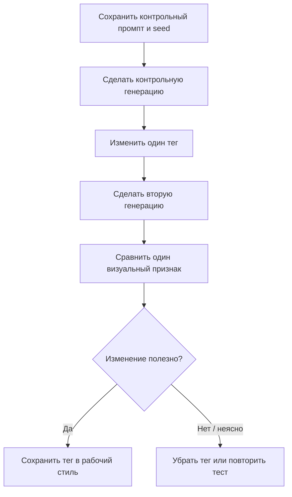

# 05 — Лаборатория сравнений

Эта глава превращает подбор стиля в контролируемый эксперимент. Не надо заранее знать, какой тег «должен быть красивым». Ты сравниваешь картинки и записываешь то, что реально увидел.

## 1. Правило одного изменения

Плохой эксперимент: первая генерация с новым промптом, seed, sampler, размером и IP-Adapter; вторая — с другими параметрами. Вывод сделать невозможно.

Хороший эксперимент: один промпт, тот же seed, те же sampler, steps, CFG и разрешение; меняется ровно один тег.



## 2. Контрольный промпт

Используй его как тестовый стенд. Персонаж и фон достаточно простые, чтобы было легче замечать тени и линии.

### Позитивный
```text
masterpiece, best quality, amazing quality,
1girl, solo, long hair, blue eyes, white shirt,
portrait, looking at viewer,
plain background
```

### Негативный
```text
bad quality, worst quality, worst detail, sketch, censor
```

Параметры для контрольного прогона: Euler a, 25 steps, CFG 6, один фиксированный seed, одно разрешение. Запиши свои реальные параметры, если используешь другие.

## 3. Тест A/B: тени

**A — контроль:** без дополнительного тега затенения.

**B — тест:** добавь `soft shading`.

Смотри только на границы теней на щеке, переход светлого участка в тёмный, тени под подбородком и ощущение плавности поверхности. Не оценивай сейчас волосы и фон.

Потом повтори тест с `cel shading` вместо `soft shading`.

## 4. Тест A/B: линии

**A:** `clean lineart`.

**B:** `delicate lineart`.

Смотри только на толщину, резкость и заметность контуров вокруг лица и волос. Если разницы почти нет, это полезный результат: на этой сцене и с этим seed модель не сильно разделила эти выражения.

## 5. Тест A/B: цвет

**A:** `warm color palette`.

**B:** `vibrant colors`.

Это не одно и то же: warm — про преобладающий цветовой тон; vibrant — про насыщенность. Сравни температуру цвета отдельно от насыщенности. После этого можно попробовать их вместе.

## 6. Тест A/B: фон

**A:** `forest, detailed background`.

**B:** `forest, sunlight through trees, moss-covered stones, stream, detailed background`.

В B добавились конкретные объекты. Сравни, стал ли фон содержательнее и логичнее. Это показывает, почему тег детализации не заменяет описание сцены.

## 7. Таблица журнала экспериментов

Скопируй таблицу в заметки или создай issue в репозитории для каждого теста.

| Дата | Seed | Изменённый тег | Что сравнивал | Разница | Решение |
|---|---|---|---|---|---|
| — | — | `soft shading` | плавность теней на лице | заметно / мало / нет | оставить / убрать / повторить |
| — | — | `clean lineart` | контуры | заметно / мало / нет | оставить / убрать / повторить |
| — | — | `warm lighting` | оттенок света | заметно / мало / нет | оставить / убрать / повторить |
| — | — | `detailed background` | количество деталей | заметно / мало / нет | оставить / убрать / повторить |

## 8. Как решать, что тег действительно помогает

Оставляй тег, если:
- эффект заметен в нужной части изображения;
- он повторяется в нескольких попытках;
- он не ломает другие важные элементы;
- итоговая картинка ближе к цели.

Не обязательно оставлять тег только потому, что он популярен в чужих промптах.

## 9. Карточка личного стиля

Заполняй по фактическим результатам, а не заранее:
- **Линии:** …
- **Тени:** …
- **Освещение:** …
- **Цвета:** …
- **Детали волос:** …
- **Кожа:** …
- **Фон:** …
- **Композиция:** …
- **Нежелательные эффекты:** …
- **Рабочие параметры Forge:** …
- **Контрольный seed:** …

## 10. Если хочется менять несколько вещей сразу

Сначала выбери базовые свойства, которые уже работают. Затем меняй по одной категории:
1. тени;
2. линии;
3. свет;
4. цвет;
5. фон;
6. детали и текстура.

Когда отдельные элементы понятны, можно собирать их в постоянный блок стиля. Если итог перестал работать, вернись к последней версии, где результат был предсказуем.

## Итог

Стиль — не одно магическое слово. Это сочетание нескольких наблюдаемых характеристик. Самый надёжный способ узнать, как тег действует именно в твоей среде, — фиксировать настройки, сравнивать и записывать результат.